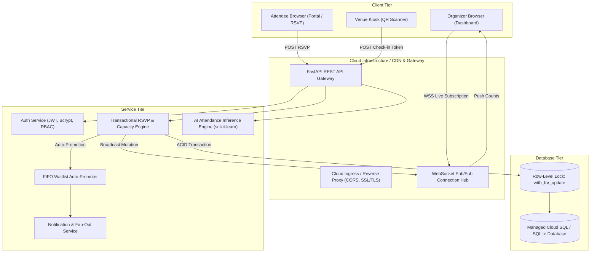
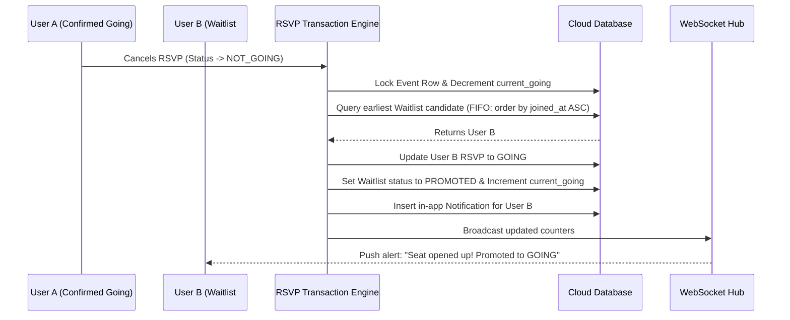

# Real-Time Cloud-Based Event Planning & RSVP Tracker

[](https://github.com/cloud-computing-course/real-time-cloud-rsvp-tracker/actions)
[](https://fastapi.tiangolo.com)
[](https://react.dev)
[](https://developer.mozilla.org/en-US/docs/Web/API/WebSockets_API)
[](https://www.docker.com)
[](https://opensource.org/licenses/MIT)

> **Industry-Oriented Cloud Computing Course Capstone Project**  
> A distributed, reactive cloud platform for real-time event capacity orchestration, frictionless digital QR invitations, concurrency-safe RSVP transactions, automated FIFO waitlist promotion, and predictive attendance machine learning.

---

## Table of Contents
1. [Overview & Problem Statement](#overview--problem-statement)
2. [Cloud Computing Architecture](#cloud-computing-architecture)
3. [Core Cloud Concepts Demonstrated](#core-cloud-concepts-demonstrated)
4. [Technology Stack](#technology-stack)
5. [User Roles & RBAC Matrix](#user-roles--rbac-matrix)
6. [Concurrency, Race Conditions & Capacity Safety](#concurrency-race-conditions--capacity-safety)
7. [FIFO Waitlist Auto-Promotion Logic](#fifo-waitlist-auto-promotion-logic)
8. [Real-Time WebSocket Architecture](#real-time-websocket-architecture)
9. [AI Attendance Prediction Model](#ai-attendance-prediction-model)
10. [REST API Specification](#rest-api-specification)
11. [Installation & Local Simulation Guide](#installation--local-simulation-guide)
12. [Multi-User Real-Time Simulation](#multi-user-real-time-simulation)
13. [Cloud Deployment Strategy (Free-Tier & Enterprise)](#cloud-deployment-strategy)
14. [Automated Testing (25 Scenarios)](#automated-testing)
15. [Security, Scalability & Failure Handling](#security-scalability--failure-handling)
16. [Academic Report & Placement Resources](#academic-report--placement-resources)

---

## Overview & Problem Statement

### The Problem
Traditional event coordination using static spreadsheets, email RSVPs, or chat groups collapses under real-world conditions:
- **Duplicate RSVPs & Double-Bookings:** Lack of database-level concurrency control causes overbooking past venue fire limits.
- **Latency & Stale Telemetry:** Organizers must manually refresh pages to track guest arrivals, leading to catering waste and seating chaos.
- **High Friction Invites:** Forcing guests to download apps or register accounts leads to high drop-off rates.
- **No-Show Uncertainty:** Event planners struggle to anticipate attendee dropout patterns.

### The Cloud Solution
This platform provides:
1. **Centralized Cloud Database:** Single source of truth with ACID transactions and row-level locking (`with_for_update`).
2. **Push-Based Real-Time Sync:** WebSockets push live seat count mutations instantly to organizer dashboards.
3. **Frictionless QR Invitations:** Unique cryptographic tokens (`/rsvp?e={id}&t={token}`) allow 1-click responses without prior sign-in.
4. **On-Site QR Check-in Kiosk:** Camera scanner rejects duplicate entries and logs check-in timestamps.
5. **Predictive Analytics:** Embedded scikit-learn ML pipeline predicts attendance probability.

---

## Cloud Computing Architecture



---

## Core Cloud Concepts Demonstrated

| Concept | Where It Appears in This Project |
| :--- | :--- |
| **SaaS (Software as a Service)** | The complete web application hosted in the cloud accessible from any device. |
| **PaaS (Platform as a Service)** | Deployment on container platforms like Google Cloud Run, Render, and Fly.io. |
| **IaaS Concepts** | Docker container orchestration, virtual networking, port binding, and volume persistence. |
| **Real-Time Push Computing** | FastAPI WebSockets persistent bi-directional channel updating live counters without polling. |
| **ACID Database Transactions** | Concurrency control during seat reservation to eliminate race conditions. |
| **Serverless & Micro-APIs** | Stateless REST endpoints and background notification fan-out tasks. |
| **RBAC Authorization** | Role-Based Access Control enforcing Organizer, Attendee, and Admin boundaries via JWT. |
| **Idempotency & Resilience** | Prevention of duplicate ticket scans and double RSVP submissions. |

---

## Technology Stack

- **Backend:** Python 3.11+, FastAPI, Uvicorn, SQLAlchemy ORM, Pydantic v2 Settings.
- **Real-Time:** WebSockets (`ConnectionManager` pub/sub broadcast room per event).
- **Security:** OAuth2 Password Bearer, PyJWT, Passlib, Bcrypt salted hashing.
- **Machine Learning:** Scikit-learn (Logistic Regression Pipeline with OneHotEncoding), Joblib, Pandas.
- **Frontend:** React 18, Vite, Tailwind CSS, Lucide React, HTML5-QRCode.
- **Containerization & CI/CD:** Docker multi-stage build, Docker Compose, GitHub Actions.

---

## User Roles & RBAC Matrix

| Capability / API Endpoint | Public / Guest | Attendee | Organizer | Administrator |
| :--- | :---: | :---: | :---: | :---: |
| View Published Events (`GET /api/events`) | Yes | Yes | Yes | Yes |
| Frictionless Token RSVP (`POST /api/rsvp/public`) | Yes | Yes | Yes | Yes |
| Authenticated RSVP (`POST /api/events/{id}/rsvp`) | No | Yes | Yes | Yes |
| Create Event (`POST /api/events`) | No | No | Yes | Yes |
| Modify Own Event (`PUT /api/events/{id}`) | No | No | Yes | Yes |
| Cancel Event (`POST /api/events/{id}/cancel`) | No | No | Yes | Yes |
| Issue VIP Token Invites (`POST /api/events/{id}/invites`) | No | No | Yes | Yes |
| Dispatch Announcements (`POST /api/events/{id}/announcements`) | No | No | Yes | Yes |
| On-Site QR Check-in (`POST /api/events/{id}/checkin`) | No | No | Yes | Yes |
| View Real-Time Dashboard (`WS /ws/events/{id}`) | No | No | Yes | Yes |

---

## Concurrency, Race Conditions & Capacity Safety

### The Naive Race Condition Flaw
Suppose event capacity is **100**, and **99** seats are confirmed. User A and User B click "Going" within milliseconds of each other.
- **Thread 1:** Reads `current_going = 99`. Condition `99 < 100` passes.
- **Thread 2:** Reads `current_going = 99`. Condition `99 < 100` passes.
- **Thread 1:** Inserts RSVP. Increments `current_going = 100`.
- **Thread 2:** Inserts RSVP. Increments `current_going = 101` (**OVERBOOKING ERROR!**).

### The Concurrency-Safe Solution
In `backend/services/rsvp_service.py`:
1. The event row is queried with row-level lock (`with_for_update` in PostgreSQL / transaction isolation in SQLite).
2. Capacity check and RSVP insertion/update happen in an indivisible database transaction.
3. If seats are exhausted, subsequent users are atomically routed to the **FIFO Waitlist**.

---

## FIFO Waitlist Auto-Promotion Logic



---

## REST API Specification

| Method | Endpoint | Description | Auth Required |
| :--- | :--- | :--- | :--- |
| `POST` | `/api/auth/register` | Register new user (Attendee / Organizer) | No |
| `POST` | `/api/auth/login` | Authenticate and obtain JWT Bearer token | No |
| `GET` | `/api/auth/me` | Fetch current user profile | Yes (Bearer) |
| `POST` | `/api/events` | Create a new event with capacity & deadline | Yes (Organizer) |
| `GET` | `/api/events` | List all events with status filters | No |
| `GET` | `/api/events/{id}` | Retrieve event details | No |
| `PUT` | `/api/events/{id}` | Update event details (ownership verified) | Yes (Organizer) |
| `POST` | `/api/events/{id}/cancel` | Mark event as cancelled | Yes (Organizer) |
| `POST` | `/api/events/{id}/rsvp` | Submit or update RSVP (Going, Maybe, Not Going) | Yes (Bearer) |
| `POST` | `/api/rsvp/public` | Submit frictionless RSVP using invite token | No |
| `POST` | `/api/events/{id}/invites` | Generate batch of unique tokens & QR links | Yes (Organizer) |
| `POST` | `/api/events/{id}/announcements` | Publish announcement & fan-out notifications | Yes (Organizer) |
| `GET` | `/api/notifications` | Fetch attendee in-app notifications | Yes (Bearer) |
| `POST` | `/api/events/{id}/checkin` | Check in attendee via token with duplicate guard | Yes (Organizer) |
| `GET` | `/api/events/{id}/analytics` | Compute capacity utilization & response metrics | Yes (Organizer) |
| `POST` | `/api/events/{id}/analytics/predict-attendance` | ML predictive attendance scoring | Yes (Organizer) |
| `WS` | `/ws/events/{id}` | Real-time WebSocket connection for live counts | No |

---

## Installation & Local Simulation Guide

### Prerequisites
- Python 3.10+
- Node.js 18+ and npm 9+
- Git

### 1. Clone & Setup Backend
```bash
# Clone the repository
git clone https://github.com/your-username/Real-Time-Cloud-Event-RSVP-Tracker.git
cd Real-Time-Cloud-Event-RSVP-Tracker

# Install Python backend dependencies
pip install -r requirements.txt

# Start backend server
uvicorn backend.main:app --reload --port 8000
```
Backend will be live at: `http://localhost:8000` (API docs at `http://localhost:8000/docs`).

### 2. Setup Frontend
```bash
# In a new terminal window
cd frontend
npm install
npm run dev
```
Frontend will be live at: `http://localhost:5173`.

---

## Multi-User Real-Time Simulation

To prove real-time synchronization across multiple distributed clients:

1. **Browser 1 (Organizer Hub):** Navigate to `http://localhost:5173/organizer`. Create event "Cloud Computing Workshop" with capacity = 2. Notice live counts: `Going: 0, Maybe: 0, Not Going: 0, Available: 2`.
2. **Browser 2 (Attendee A - Incognito):** Navigate to `http://localhost:5173/attendee`. Click **Going**.
   - *Observation:* Browser 1 organizer counters immediately update to `Going: 1, Available: 1` **without page refresh**.
3. **Browser 3 (Attendee B - Different Browser):** Navigate to `http://localhost:5173/attendee`. Click **Going**.
   - *Observation:* Browser 1 updates to `Going: 2, Available: 0, Status: FULL`.
4. **Browser 4 (Attendee C):** Navigate to `http://localhost:5173/attendee`. Click **Going**.
   - *Observation:* Event is full; Attendee C is placed on FIFO Waitlist. Browser 1 shows `Waitlist: 1`.
5. **Attendee A changes response to "Not Going":**
   - *Observation:* Attendee A releases their seat; Attendee C is automatically promoted to "Going". Browser 1 shows `Going: 2, Waitlist: 0`.

---

## Cloud Deployment Strategy

### Option A: Free-Tier Containerized Cloud (Render / Fly.io / GCP Cloud Run)
Using the provided `Dockerfile` and `deploy/render.yaml`:
```bash
# Google Cloud Run deployment:
chmod +x deploy/cloudrun_deploy.sh
./deploy/cloudrun_deploy.sh <your-gcp-project-id>
```

### Option B: Enterprise AWS Architecture
- **CDN:** AWS CloudFront for frontend static assets.
- **Frontend Hosting:** AWS S3 Static Website.
- **API Gateway:** AWS HTTP API Gateway + WebSocket API Gateway for persistent connections.
- **Compute:** AWS ECS Fargate or AWS Lambda serverless functions.
- **Database:** Amazon RDS PostgreSQL (Multi-AZ) with connection pooling.
- **Notifications:** Amazon SNS (SMS / Push) and SES (Email).

---

## Automated Testing

Run the automated test suite of 25 comprehensive scenarios:
```bash
python -m pytest tests/test_full_suite.py -v
```

All 25 test cases verify registration, token authorization, duplicate prevention, registration deadlines, capacity concurrency, FIFO waitlist promotion, announcements, analytics, check-ins, and error rollbacks.

---

## Academic Report & Placement Resources

All course capstone deliverables and interview prep resources are located in the `docs/` directory:
- 📖 [Comprehensive Academic Capstone Report](docs/PROJECT_REPORT.md) (Abstract, Architecture, Concurrency Proof, Scalability Analysis)
- 💼 [10 Predicted Technical Interview Questions & Answers](docs/INTERVIEW_PREP.md)
- 📄 [Resume Bullet Points & LinkedIn Portfolio Guide](docs/RESUME_GUIDE.md)
- 📸 [Day-by-Day Development Diary & 28-Screenshot Checklist](docs/PORTFOLIO_PROOF.md)

---

## License
Distributed under the MIT License. See `LICENSE` for more information.

---

## 🚀 How to Run the Server and Frontend (Quick Start Guide)

Follow these simple steps to run both the FastAPI backend and React frontend locally:

### 1. Start the Backend Server (Terminal 1)
Open a terminal in the project root directory (`F:\Git\AI\sigmoid`):

```bash
# Install dependencies (first time only)
pip install -r requirements.txt

# Start FastAPI backend server
python -m uvicorn backend.main:app --port 8000
```

> **Tip for Windows PowerShell:** If you want automatic reloading during development, use:  
> `python -m uvicorn backend.main:app --reload --port 8000`  
> *(Note: In Git Bash, run without `--reload` to prevent mintty terminal EOF signals)*

- **Backend API:** `http://localhost:8000`
- **Interactive Swagger Docs:** `http://localhost:8000/docs`

---

### 2. Start the Frontend Web App (Terminal 2)
Open a **second terminal** and navigate to the `frontend/` folder:

```bash
cd frontend

# Install Node packages (first time only)
npm install

# Start Vite React dev server
npm run dev
```

- **Frontend Application:** Open **[`http://localhost:5173`](http://localhost:5173)** in your browser!

---

### 3. Demo Credentials for Immediate Testing

The database automatically pre-seeds demo accounts on server startup:

| Persona | Email | Password | Role / Access |
| :--- | :--- | :--- | :--- |
| **Organizer** | `organizer@cloud.edu` | `Password123!` | Organizer Hub, Create Events, VIP Invites, Kiosk Scanner |
| **Attendee** | `attendee@cloud.edu` | `Password123!` | Attendee Portal, Discover Events, Live RSVP |

You can also click **"Register"** in the app to create your own custom accounts.
-------
Author
----
Abhishek Basu — Embedded Systems Student GitHub: [DevAbhay2003](https://github.com/DevAbhay2003?tab=repositories) · LinkedIn: [Abhishek Basu](https://www.linkedin.com/in/abhishek-basu-68b1b1342/)
